<p align="center">
  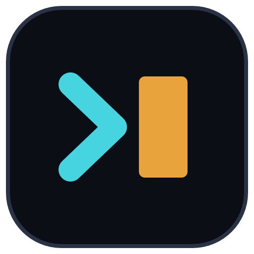
</p>

<h1 align="center">Vo-Coder</h1>

<p align="center">
  <strong>Your workspace. Your AI team. Your choice of models.</strong><br/>
  A personal computing environment built around working with AI — projects, agents, creative studios, a 3D world of your code, and memory that stays yours.
</p>

<p align="center">
  <a href="https://vodozine.github.io/vo-coder/"><strong>Website</strong></a> ·
  <a href="https://github.com/Vodozine/vo-coder/releases/latest"><strong>Download</strong></a> ·
  <a href="https://github.com/Vodozine/vo-coder/discussions"><strong>Discussions</strong></a> ·
  <a href="#whats-inside">Features</a>
</p>

<p align="center">
  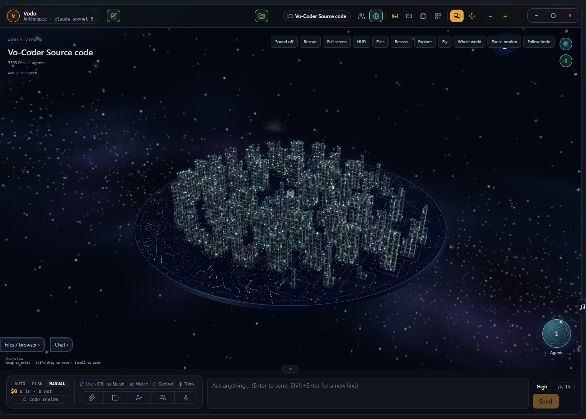
</p>

---

## What is Vo-Coder?

Vo-Coder brings your projects, AI agents, creative studios, and memory together in one desktop app. Build software, make music, design, run your homelab, and work on documents with an assistant called **Vodo** and a team you put together yourself.

- **One workspace, two ways to see it.** Use the normal interface — chat beside live tiles, diffs, previews, and files — or step into **World View**, where every folder is a platform, every file is a building with readable code walls, and agents fly to the files they edit. Switch the world off anytime and the 3D scene unloads completely.
- **Any model, any mix.** Cloud APIs (Anthropic, OpenAI, Google Gemini, OpenRouter, xAI, Z.ai, NVIDIA), local servers (Ollama, LM Studio, llama.cpp, FLM on an NPU), and coding CLIs you already pay for (Claude Code, Codex, OpenCode, Kimi, Muse, Antigravity).
- **The soul and the brain.** Models come and go; your assistant's identity, your rules, decisions, tasks, lessons, and conversation archives live on your machine outside any one model.

## Screens

<p align="center">
  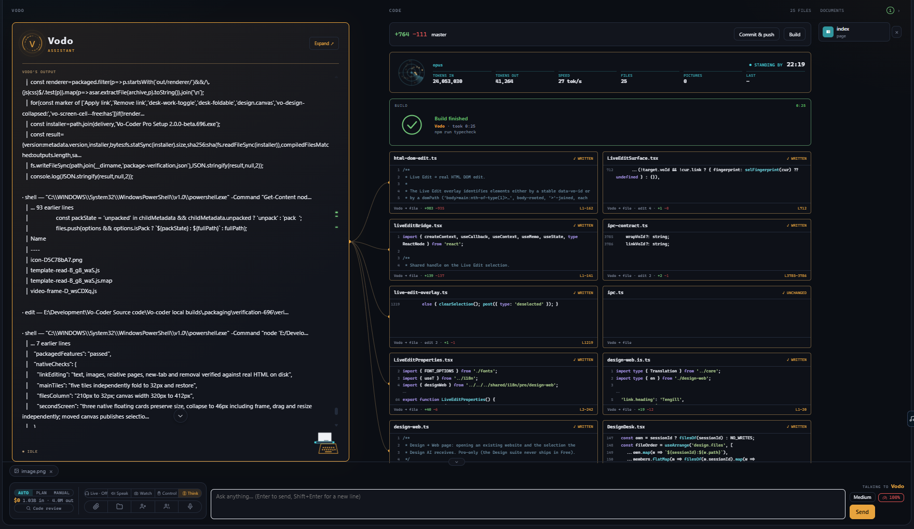<br/>
  <sub>Code mode: Git changes with Commit &amp; push, one-click Build, token meters, and every file the agent touches, updated live.</sub>
</p>

<p align="center">
  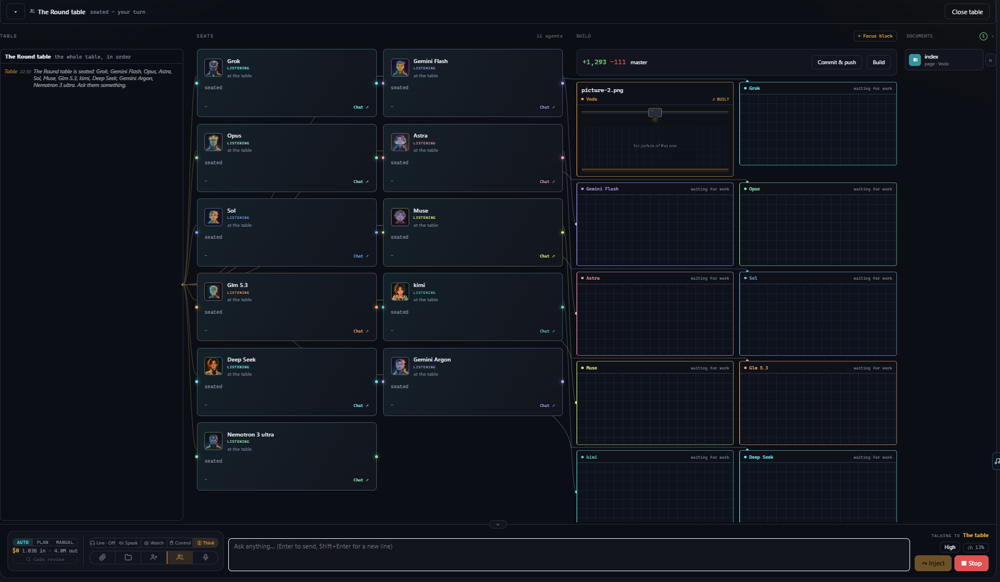<br/>
  <sub>The Round Table: eleven agents seated and listening, with their own chats and connected output panels.</sub>
</p>

<p align="center">
  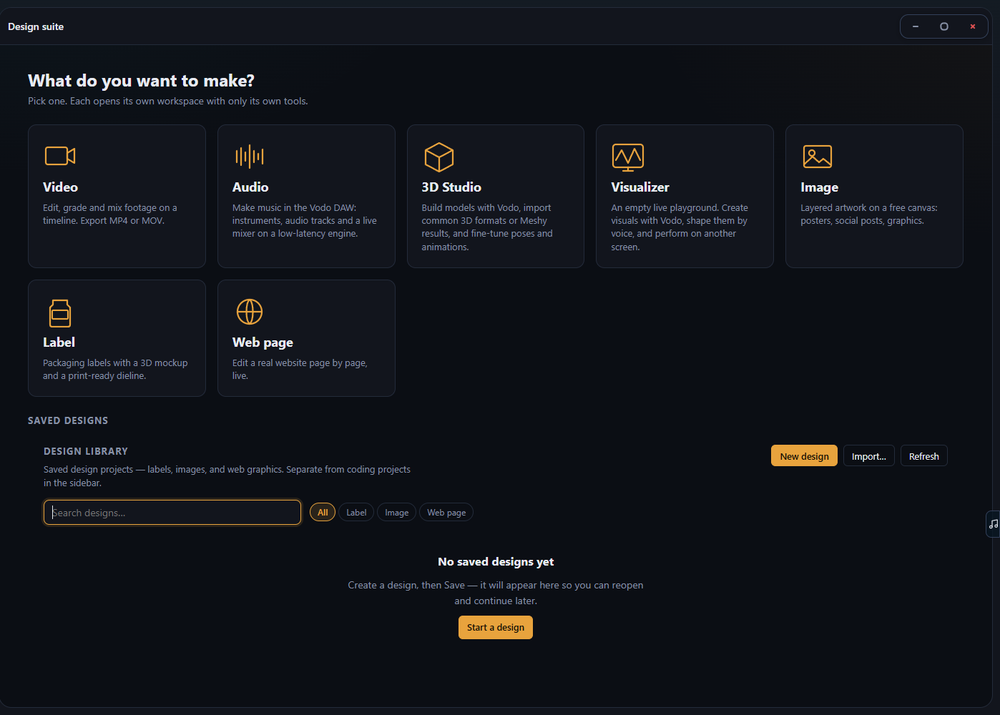<br/>
  <sub>Design suite: seven creative studios, with Vodo working inside every one in the same conversation.</sub>
</p>

<table>
  <tr>
    <td width="50%">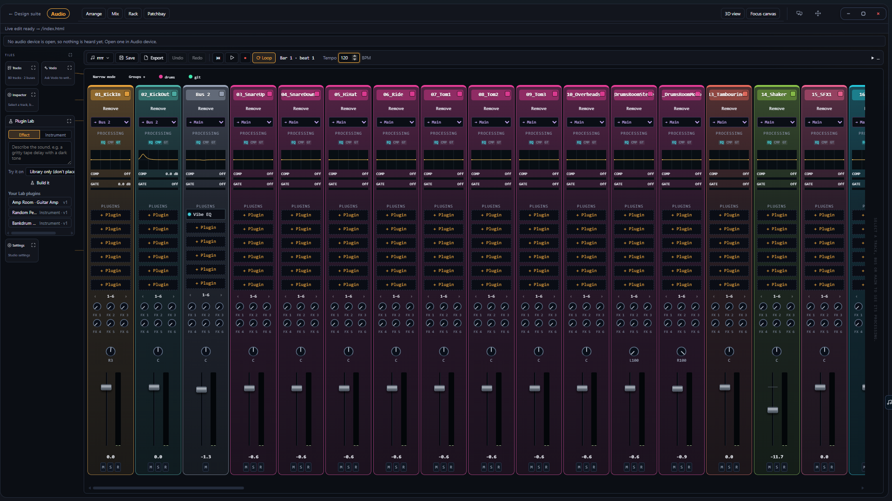<br/><sub>Audio DAW mixer: channels, buses, EQ, compression, gates, FX sends, and VST3/CLAP plugin slots.</sub></td>
    <td width="50%">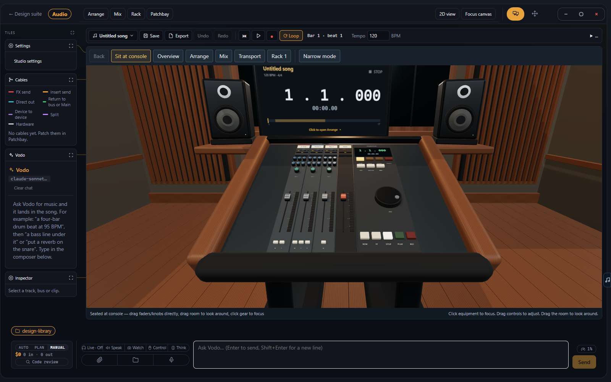<br/><sub>3D studio room: sit at the console and move faders and knobs directly.</sub></td>
  </tr>
  <tr>
    <td>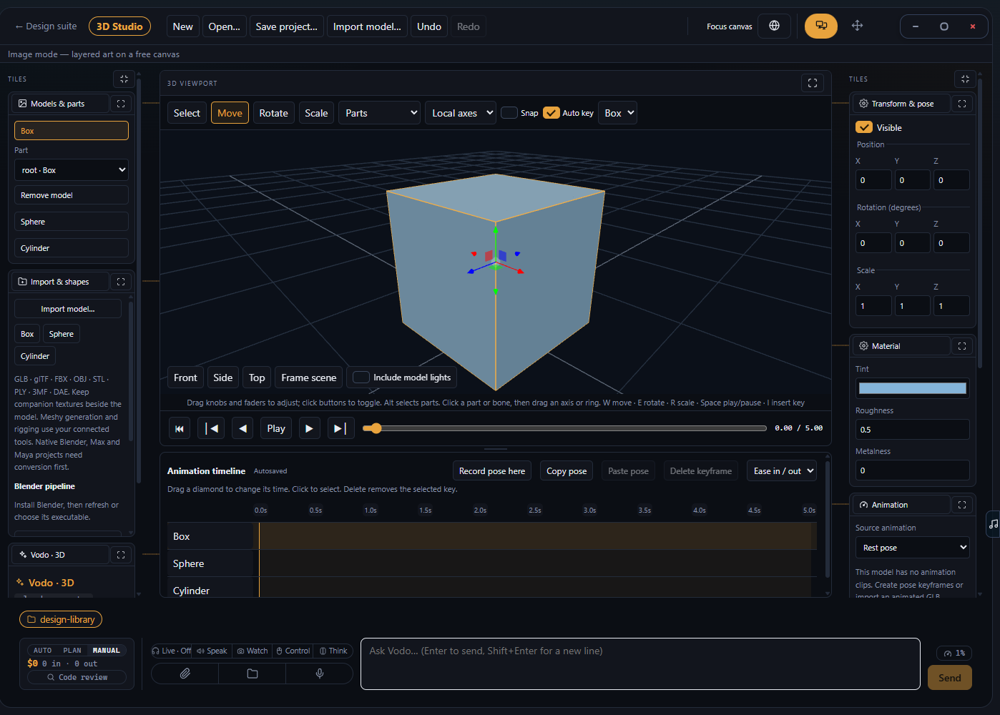<br/><sub>3D Studio + Blender bridge: compose shapes, import models, pose bones, and animate.</sub></td>
    <td>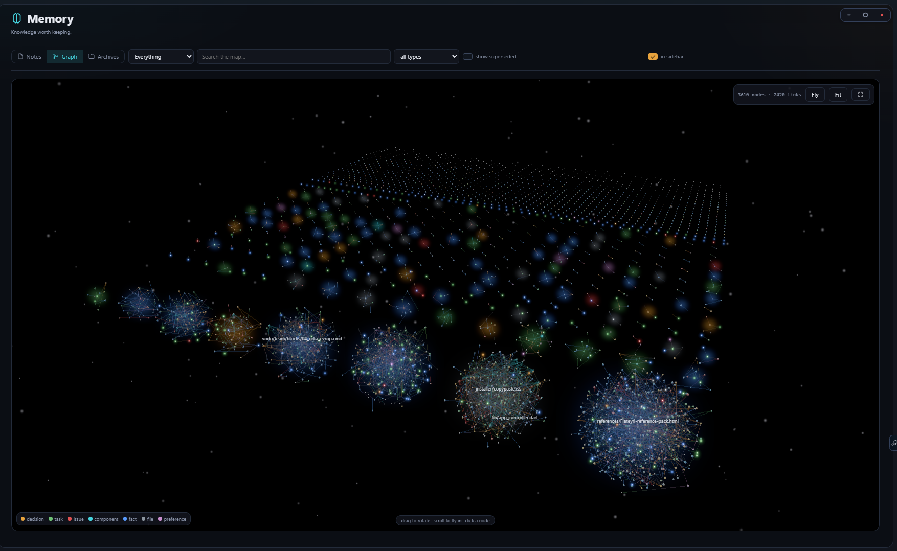<br/><sub>Memory galaxy: 3,610 nodes and 2,420 links across projects you can fly through.</sub></td>
  </tr>
  <tr>
    <td>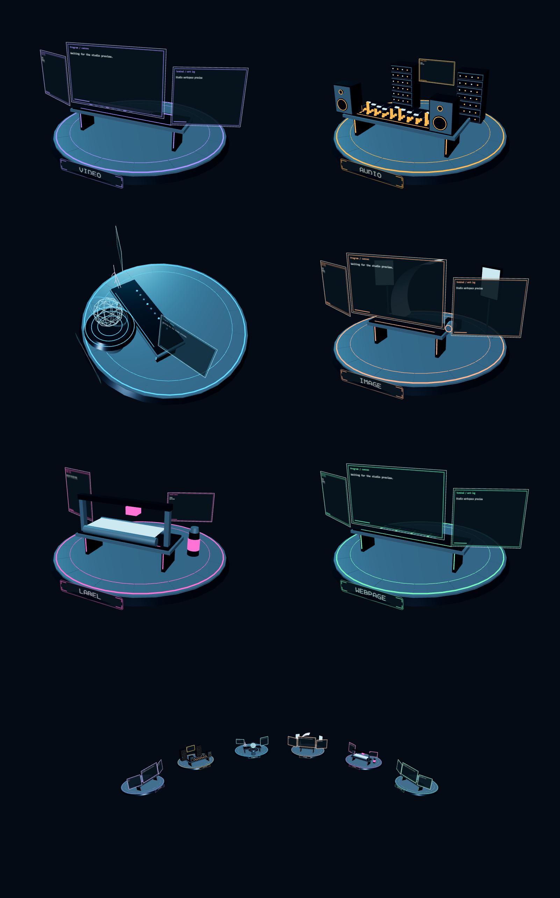<br/><sub>Studio platforms in World View, each connected to its own editor.</sub></td>
    <td>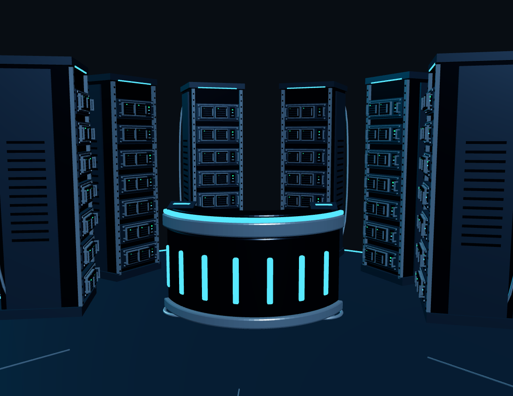<br/><sub>Mr Homelab: Proxmox machines, containers, snapshots, and backups.</sub></td>
  </tr>
  <tr>
    <td>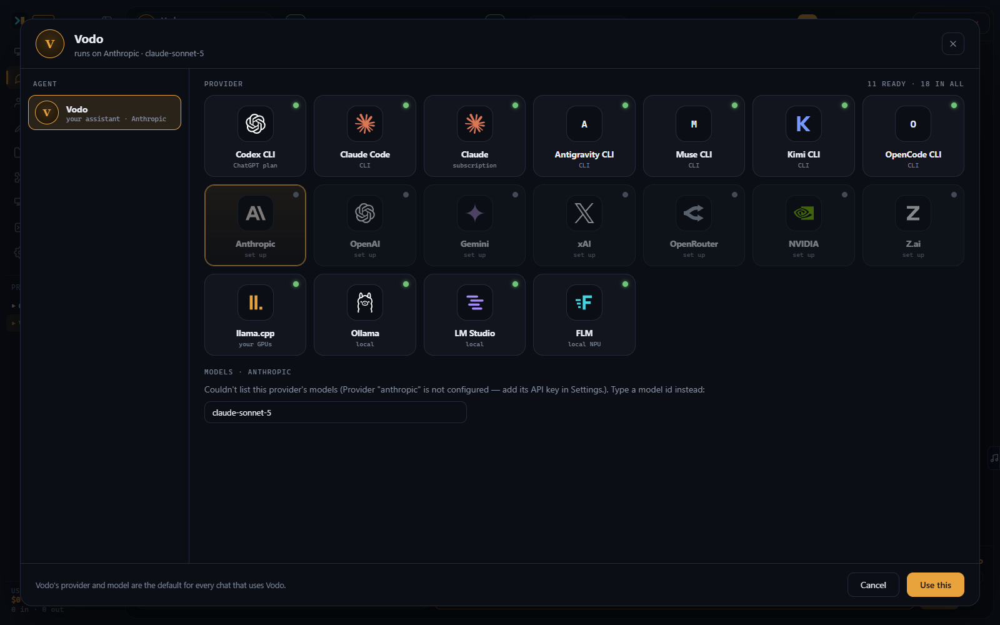<br/><sub>18 providers: cloud APIs, local Ollama/LM Studio/llama.cpp/FLM, and coding CLIs.</sub></td>
    <td>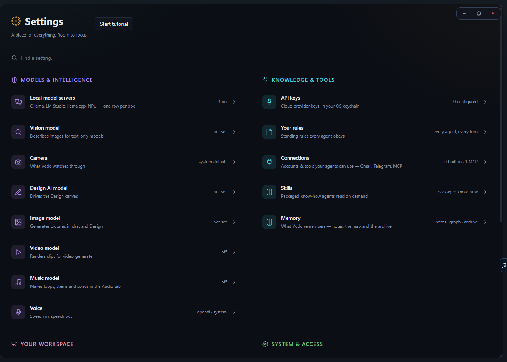<br/><sub>Everything on one Settings page, with a guided walkthrough when you want it.</sub></td>
  </tr>
</table>

See all 22 screenshots and the full searchable feature index on the **[website ↗](https://vodozine.github.io/vo-coder/)**.

## What's inside
<a id="whats-inside"></a>

### World View & Workspace
- **3D project city** — folders become platforms, files become buildings, and code appears on walls you can read, scroll, select, and ask about directly. Walk with WASD, fly freely, or follow any agent to its work.
- **Live work-column tiles** — KPIs, tables, charts, lists, calculators, quizzes, image cards, dashboards, and custom graphics appear beside the chat. Pin tiles to the project, save reusable widgets, and spread panels across displays.
- **Decisions on cards** — when you need to choose, Vodo puts short options and a recommendation on a card instead of burying them in text.
- **Project modes** — **General**, **Code**, **Business**, **School**, **Chemistry**, and **Investment** automatically shape the workspace and agent approach.
- **Software development & Office** — live code view with diffs, built-in Git changes & Commit/push, one-click Build, code map, terminal, split views, app preview, plus native Word, Excel, and PowerPoint tools.

### Your AI team
- **18 providers** — cloud APIs, multi-endpoint local servers (Ollama, LM Studio, llama.cpp, FLM on NPU), and coding CLIs (Claude Code, Codex, OpenCode, Kimi, Muse, Antigravity) using their own logins.
- **Built for small local models** — local models start with a tiny tool set and open one tool category at a time, and can run several tools in one step through sandboxed **tool scripts** (every call still asks for approval).
- **Routing, groups, teams & missions** — automatic capability/cost routing, visible **Group projects** with optional Git worktrees, **Saved teams** and **Round-table meetings**, visual **Pipelines**, **Missions** on a schedule, and an **Activity** dashboard with usage meters.
- **Colleagues vs. hired help** — toggle project memory per agent so specialists stay focused on their brief.

### Seven creative studios
- **Audio DAW** — arrange, MIDI editing, 16+ channel mixer, effects rack, 80-channel patchbay, 3D console room, native low-latency C++ engine (WASAPI/ASIO), VST3 & CLAP hosting, Plugin Lab, oscilloscope XY drawing, and WAV/MP3/FLAC export.
- **3D Studio + Blender** — compose shapes, import GLB/FBX/OBJ, edit materials and bone poses, animate keyframes, export animated GLB, and run local Blender Python that imports straight back into the studio.
- **Visualizer** — live visual playground with independent layers, numeric sliders, voice control, saved scenes, and second-display fullscreen output.
- **Video** — timeline with ripple/roll/slip/razor tools, keyframes, color grading, compositing, transitions, markers, and MP4/MOV export.
- **Web page, Image & Label** — live on-page website editor with shared agent undo, layered image canvas, packaging labels with barcodes, 3D mockups, and print dielines, plus Unity & Unreal MCP bridges.

### Memory, voice, devices & extensions
- **Soul & Brain memory** — local SQLite conversation archives, distilled memory map of decisions/tasks/facts/files, smart context briefings, 3D memory galaxy, **Lessons** learned from corrections, and **Skill drafts**.
- **Live voice & dictation** — real-time spoken conversation while Vodo operates the workspace and browser, offline whisper.cpp dictation, and per-agent voices.
- **Beyond one screen** — **Coordinator mode** dispatching tasks across workstations and VMs, self-hosted Docker backend, **Phone pairing** with encrypted Messages & Vo-Calling, **Telegram** remote control, built-in **Vodomation smart-home hub** with a 3D house twin (Zigbee2MQTT, MQTT), **Proxmox homelab** tools, browser & desktop control, camera, navigation, and Google services.
- **Modules, skills & MCP** — build new widgets, screens, background services, hardware status lights, and hardware controllers directly inside Vo-Coder; import skills or connect any MCP server.
- **Control** — **Auto**, **Plan** (read-only), and **Manual** modes, OS keychain secret storage, workspace path containment, and explicit permission prompts.

## Install

Grab the latest public release installer from **[Releases](https://github.com/Vodozine/vo-coder/releases/latest)** — Windows (auto-updating), macOS (Apple Silicon and Intel), and Linux AppImage.

**macOS:** open the DMG and drag Vo-Coder to Applications (`arm64` for Apple Silicon, `x64` for Intel). On first launch, **right-click → Open → Open** (unsigned open-source build). If macOS reports the app is *"damaged"*, run once in Terminal:

```bash
xattr -cr /Applications/Vo-Coder.app
```

On first run: add an API key, sign in with a supported coding CLI, or connect a local Ollama / LM Studio / llama.cpp server — and say hello to Vodo.

## License

See [LICENSE](LICENSE).

---

<p align="center"><sub>Vo-Coder — your workspace, with AI. 🤍</sub></p>
